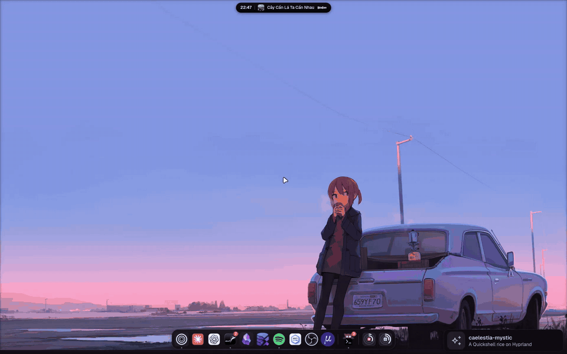
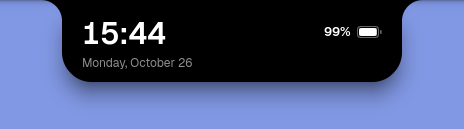
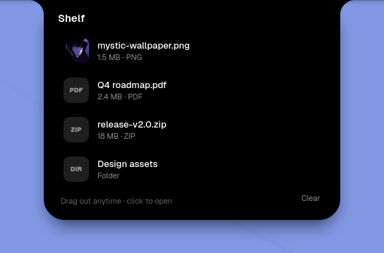
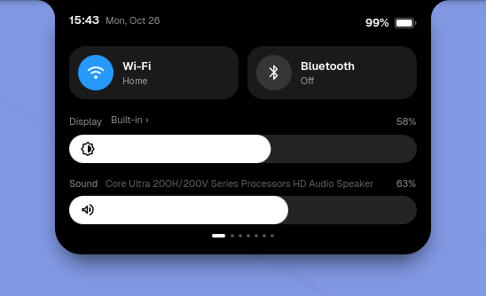
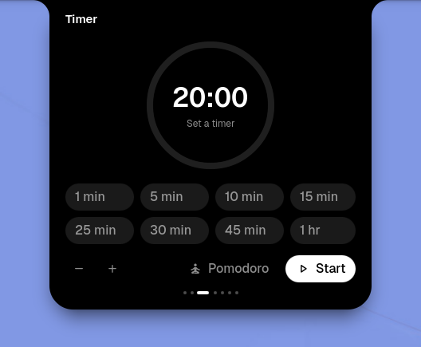
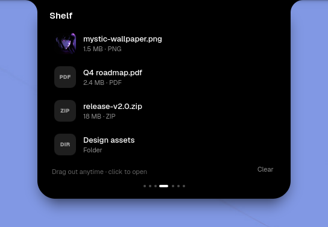
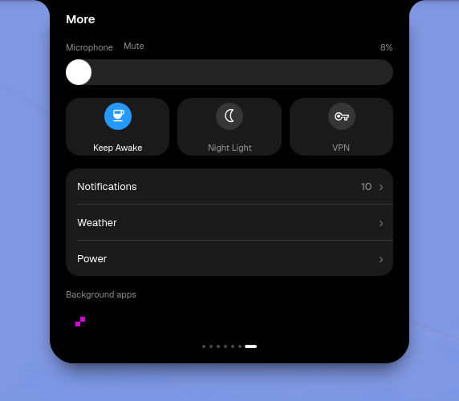
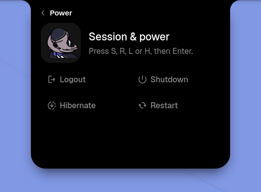

# caelestia-mystic

My Quickshell rice for Hyprland, built on top of the [caelestia](https://github.com/caelestia-dots/shell) shell.



🎬 **[Watch the full showcase (1920×1200, 60fps, ~2 min)](https://github.com/namdang-fdp/caelestia-mystic/releases/tag/showcase-2026-10-22)**

## Highlights

- **Dynamic Island**: a pure black notch hanging from the top edge (concave corners, spring morphs), styled after iOS and [Nusa](https://rama2555.github.io/nusa)
  - Resting notch shows the clock beside a small idle companion: soft round eyes that blink, glance, smile when you hover and doze off while you are away
  - Hover peeks at what is happening now: music, a running timer, the file shelf, or the time, date and battery
  - Click opens a carousel with a floating dot island underneath: Home, Controls, Media, Timer, Agent, Shelf, Clipboard, Windows, More; turn pages with a two-finger swipe, A/D, ←/→ or the dots
  - Home brings together music, timer, battery/device levels, today's note and a contextual file shelf; Customize saves card visibility and order
  - Tools page (`dynamicIsland open tools`): notes, to-do, world clocks, box breathing, and a Focus tab with Quiet, Presenting, timed Keep awake, eye breaks and a Liquid Glass option
  - Island pages are grouped in three sections, Now (home, media, timer, agent), Control (controls, windows, more) and Tools (tools, shelf, clipboard), with one set of dots per section. A second running activity (timer, music, recording) slips out as its own bubble beside the notch
  - Clipboard: `@image`/`@link`/`@code`/`@app` search, pause recording, auto-delete after 1 hour / 1 day / 7 days, Copy Stack
  - Shelf tools: zip, convert to PNG/JPEG/WebP, resize and images to PDF (originals are never changed)
  - Media: choose extra buttons (±15 s, shuffle, repeat), fullscreen music show (`musicShow toggle`, five themes) and floating desktop lyrics (`musicShow lyrics`)
  - Pin the island open from the dot island; scroll over the dots to turn pages; drag cards to reorder Home
  - Agent approvals: when Claude Code asks for permission, the Agent page shows the tool and what it wants to do with Allow/Deny (questions are never answered for you) and a button that jumps to the session's window. While a request waits, the tool name and a one-line summary are kept in a private (0600) state file; they are dropped as soon as the state changes
  - Dev tab (Tools): open pull requests with CI/review state and pills when CI fails, passes or a PR is merged; listening ports of your own processes (stop with a confirm) and Docker containers; time per project from agent transcripts and a standup draft that goes to Notes. Mochi shows your level and commit streak, worries about red CI and celebrates merges
  - Long commands: `shell-hook.zsh` reports commands that ran 30 s or more (`ISLAND_CMD_THRESHOLD`) as a green or red pill. Install it with `python3 modules/dashboard/helpers/shell_setup.py install` (adds one marked block to ~/.zshrc, backed up first; `uninstall` removes it)
  - Agent companions slide out beside the Island, one per provider. They show working, waiting for input, and finished states, with dismissible popups for requests and completions. The Agent page still shows sessions, usage estimates, and Claude Code hook setup (`dynamicIsland open agent`)
  - Controls opens an audio device picker with separate Output/Input tabs; microphone mute stays as a small badge while music and other activities remain visible
  - File shelf: drop files on the notch to keep them handy, drag them back out into any app, click to open; it only keeps links, never copies
  - OSD with level bars for volume, brightness and charging; transient pills for Bluetooth devices, workspaces and track changes
  - Scroll over the notch to change volume, scroll sideways to switch between clock, lyrics and system stats
  - Countdown and Pomodoro timer that lives in the notch
  - Calendar notes, weather forecast, clipboard image previews and night light (hyprsunset/gammastep)
  - Clipboard filters All/Pinned/Text/Images/Links/Code; pinned text and images are saved locally until unpinned, independently of recent cliphist history (up to 40 items, 32 MiB each)
  - Wi-Fi and Bluetooth pages: inline password entry, known/nearby networks, pairing, device battery, forget
  - Power page with keyboard shortcuts: S shutdown, R restart, L logout, H hibernate, Enter confirms
- **Notification centre**: popups (click to open the app, images, urgent styling) and grouped history inside the island
- **macOS-style dock**: pinned and running apps, drag to reorder, window previews, badges, plus Claude and Codex plan usage tiles
- **Lock screen**: clean island-style lock with blurred wallpaper, now playing, fingerprint hints and private notification count
- **Monitor profiles**: laptop/external/dual layouts with auto mode and clamshell switching
- **Nexus settings**: wallpaper and style, audio, panels, apps and more
- **Dynamic colours**: palette regenerates from the wallpaper
- **Utilities panel**: keep awake, screen recorder, quick toggles

## Dynamic Island

The desktop companions read local 8 × 9 sprite atlases from `${XDG_CONFIG_HOME:-$HOME/.config}/caelestia/agent-pets/`. Use `codex.webp` and `claude.webp` for the two providers. The UI uses a built-in status icon if an atlas is missing. [Codex companion atlas](https://persistent.oaistatic.com/codex/pets/v1/codex-spritesheet-v4.webp) · [Clawd Pixel for personal use](https://github.com/UknownPerson/clawd-pixel-codex-pet#notes)

Codex work and completion come from local session logs. To enable Codex approval notifications, run `python3 modules/dashboard/helpers/agent_setup.py install codex`, then review the new hooks in Codex with `/hooks`.

<p align="center">
  
</p>

| Hover: nothing happening | Hover: files on the shelf |
|:---:|:---:|
|  |  |

Click the notch for the page carousel (two-finger swipe, A/D, arrow keys or the dots):

| Controls | Timer |
|:---:|:---:|
|  |  |
| **Shelf** | **More** |
|  |  |

<p align="center">
  <br>
  <sub>Power page: S shutdown, R restart, L logout, H hibernate, Enter to confirm.</sub>
</p>

## Install

Clone into the Quickshell config directory and run it:

```sh
git clone https://github.com/namdang-fdp/caelestia-mystic ~/.config/quickshell/caelestia
qs -c caelestia
```

## IPC

```sh
qs -c caelestia ipc call dynamicIsland open wifi        # controls, media, wifi, bluetooth, timer, weather, clipboard, shelf, ...
qs -c caelestia ipc call dynamicIsland open audio       # output and microphone selection
qs -c caelestia ipc call dynamicIsland open home        # overview and card customization
qs -c caelestia ipc call islandShelf add ~/file.pdf     # also: remove, clear, list
qs -c caelestia ipc call islandTimer start 25           # minutes; also: pomodoro, toggle, stop, status
qs -c caelestia ipc call monitorProfiles lid
```

Global shortcuts are exposed to Hyprland as `caelestia:<name>`. For example, to open the island power page with Super+Escape (Lua config):

```lua
hl.bind("SUPER + Escape", hl.dsp.global("caelestia:session"))
```

