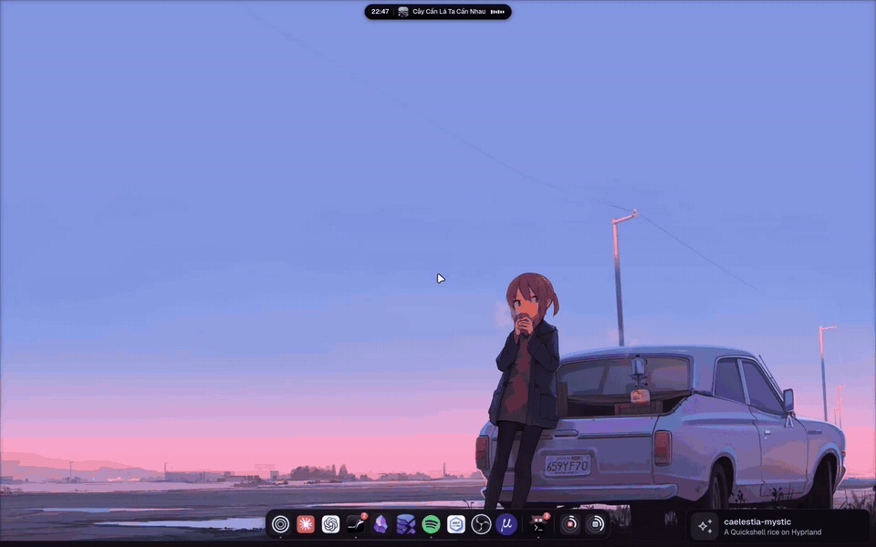
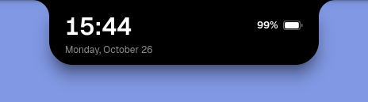
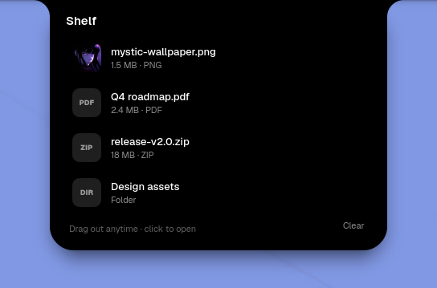
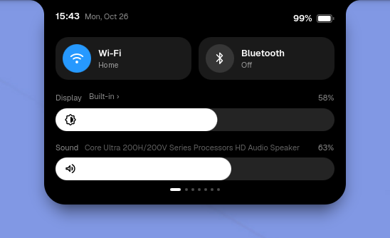
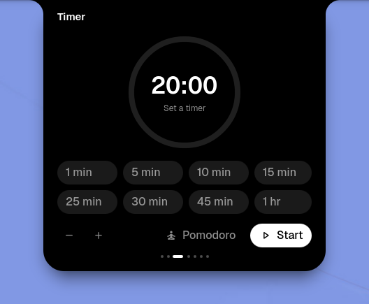
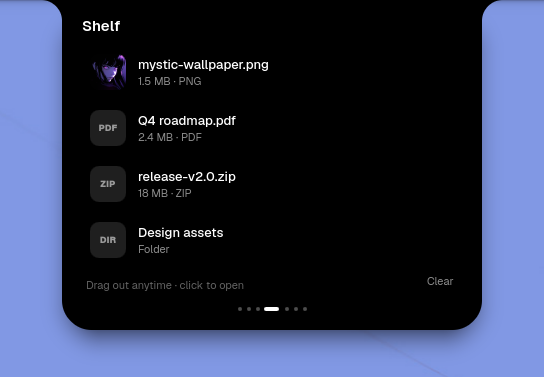
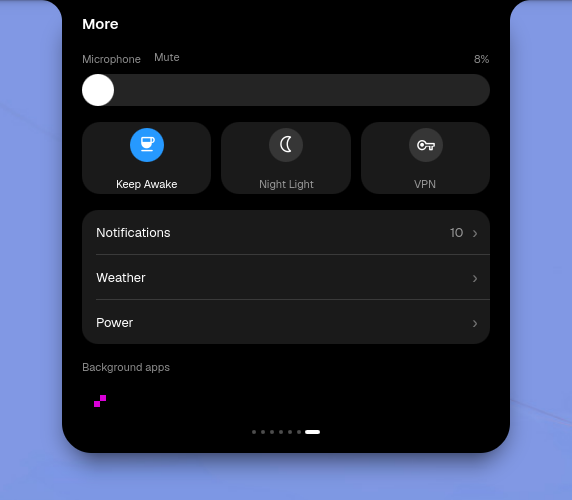
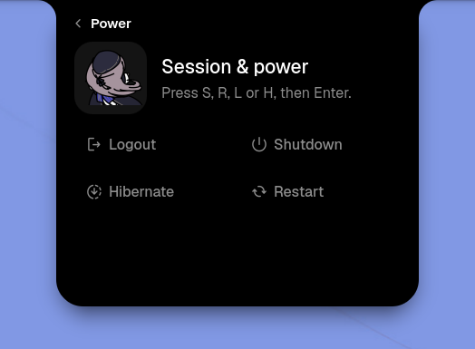

# caelestia-mystic

My Quickshell rice for Hyprland, built on top of the [caelestia](https://github.com/caelestia-dots/shell) shell.



🎬 **[Watch the full showcase (1920×1200, 60fps, ~2 min)](https://github.com/namdang-fdp/caelestia-mystic/releases/tag/showcase-2026-10-22)**

## Highlights

- **Dynamic Island**: a pure black notch hanging from the top edge (concave corners, spring morphs), styled after iOS and [Nusa](https://rama2555.github.io/nusa)
  - Resting notch shows the clock beside a small idle companion: soft round eyes that blink, glance, smile when you hover and doze off while you are away
  - Hover peeks at what is happening now: music, a running timer, the file shelf, or the time, date and battery
  - Click opens a carousel with page dots: Controls, Media, Timer, Shelf, Clipboard, Windows, More; turn pages with a two-finger swipe, A/D, ←/→ or the dots
  - File shelf: drop files on the notch to keep them handy, drag them back out into any app, click to open; it only keeps links, never copies
  - OSD with level bars for volume, brightness and charging; transient pills for Bluetooth devices, workspaces and track changes
  - Scroll over the notch to change volume, scroll sideways to switch between clock, lyrics and system stats
  - Countdown and Pomodoro timer that lives in the notch
  - Calendar notes, weather forecast, clipboard image previews and night light (hyprsunset/gammastep)
  - Wi-Fi and Bluetooth pages: inline password entry, known/nearby networks, pairing, device battery, forget
  - Power page with keyboard shortcuts: S shutdown, R restart, L logout, H hibernate, Enter confirms
- **Notification centre**: popups (click to open the app, images, urgent styling) and grouped history inside the island
- **macOS-style dock**: pinned and running apps, drag to reorder, window previews, badges, plus Claude and Codex plan usage tiles
- **Lock screen**: clean island-style lock with blurred wallpaper, now playing, fingerprint hints and private notification count
- **Monitor profiles**: laptop/external/dual layouts with auto mode and clamshell switching
- **Nexus settings**: wallpaper and style, audio, panels, apps and more
- **Dynamic colours**: palette regenerates from the wallpaper
- **Utilities panel**: keep awake, screen recorder, quick toggles

## Dynamic Island

<p align="center">
  
</p>

| Hover: nothing happening | Hover: files on the shelf |
|:---:|:---:|
|  |  |

Click the notch for the page carousel (two-finger swipe, A/D, arrow keys or the dots):

| Controls | Timer |
|:---:|:---:|
|  |  |
| **Shelf** | **More** |
|  |  |

<p align="center">
  <br>
  <sub>Power page: S shutdown, R restart, L logout, H hibernate, Enter to confirm.</sub>
</p>

## Install

Clone into the Quickshell config directory and run it:

```sh
git clone https://github.com/namdang-fdp/caelestia-mystic ~/.config/quickshell/caelestia
qs -c caelestia
```

## IPC

```sh
qs -c caelestia ipc call dynamicIsland open wifi        # controls, media, wifi, bluetooth, timer, weather, clipboard, shelf, ...
qs -c caelestia ipc call islandShelf add ~/file.pdf     # also: remove, clear, list
qs -c caelestia ipc call islandTimer start 25           # minutes; also: pomodoro, toggle, stop, status
qs -c caelestia ipc call monitorProfiles lid
```

Global shortcuts are exposed to Hyprland as `caelestia:<name>`. For example, to open the island power page with Super+Escape (Lua config):

```lua
hl.bind("SUPER + Escape", hl.dsp.global("caelestia:session"))
```

